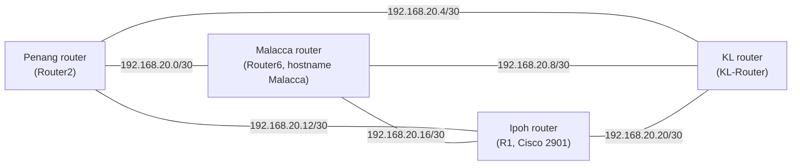
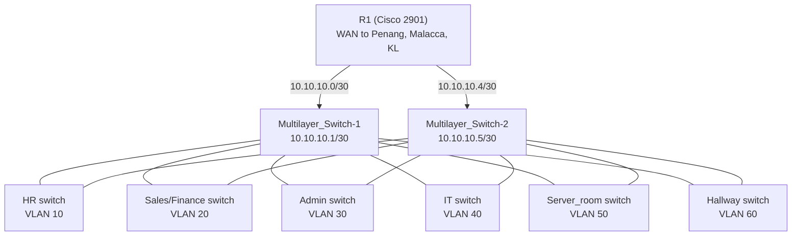
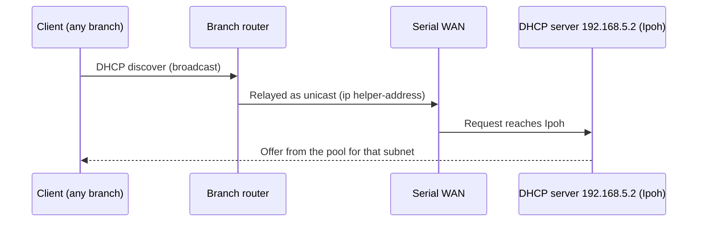

# MapleTech Network Architecture (Cisco Packet Tracer)

An enterprise network design for a fictional company, **MapleTech**, built in **Cisco Packet Tracer** for an academic assessment. It connects **four branches (Penang, Malacca, Kuala Lumpur and Ipoh)** over a serial WAN, gives each branch its own subnetted LAN, routes between them with **static routes**, and hosts the company's **DHCP, DNS, web, email and file servers**. Every branch also carries IoT devices (cameras, smoke detectors, sprinklers, door and window sensors, air conditioners and more).

The whole design lives in one Packet Tracer file, `Working_Assignment_Final[1].pkt` (saved with Packet Tracer 8.2.1).

---

## Table of contents

1. [What the project contains](#what-the-project-contains)
2. [Technology](#technology)
3. [WAN topology](#wan-topology)
4. [The four branches](#the-four-branches)
5. [IP addressing](#ip-addressing)
6. [Routing](#routing)
7. [Server and DHCP design](#server-and-dhcp-design)
8. [Project structure](#project-structure)
9. [How to open and use the file](#how-to-open-and-use-the-file)
10. [Suggested walkthrough](#suggested-walkthrough)
11. [Security notes](#security-notes)
12. [Limitations and next steps](#limitations-and-next-steps)

---

## What the project contains

The numbers below were read from the saved topology.

| Item | Count |
|---|---|
| Devices on the canvas | 184 |
| Cable links | 144 (136 copper, 6 serial, 2 coaxial) |
| Routers | 5 (Cisco 1941, Cisco 2901 and three generic Router-PT) |
| Multilayer switches | 2 (Cisco 3650-24PS) |
| Switches | 22 (20 x 2960-24TT, 1 x 2950T-24, 1 x Switch-PT) |
| Servers | 5 |
| Access points | 10 |
| PCs / laptops / tablet / smartphones | 31 / 4 / 1 / 10 |
| Printers, TVs, IP phone | 10, 2, 1 |
| IoT devices | 70 (air conditioners, smoke detectors, webcams, fire sprinklers, sirens, doors, and others) |
| Cloud objects, power distribution devices | 2, 9 |

Of the 184 devices, 48 have no cable attached in the file (all 9 power distribution devices, the 10 smartphones, 4 laptops, the tablet and 24 IoT devices). Only the 136 cabled devices are counted in the branch table below.

---

## Technology

| Technology | Role |
|---|---|
| Cisco Packet Tracer 8.2.1 | Design, configuration and simulation |
| Cisco IOS (routers, switches, multilayer switches) | Device configuration |
| Serial point-to-point links (/30) | WAN between the four branch routers |
| Static routing | Reachability between all branches |
| VLANs and SVIs on multilayer switches | Ipoh LAN segmentation |
| DHCP with `ip helper-address` relay | Central address assignment |
| DNS | Name resolution for `mapletech.org` |
| IPv6 (one LAN) | `2001:DB8:CAFE:A::/64` on the Penang IT router interface |

---

## WAN topology

The four branch edge routers are joined in a **full mesh** of six serial links. Each link is its own /30 inside `192.168.20.0/24`.



| Link | Subnet | End A | End B |
|---|---|---|---|
| Penang - Malacca | 192.168.20.0/30 | Penang Se4/0 `.1` | Malacca Se6/0 `.2` |
| Penang - KL | 192.168.20.4/30 | Penang Se5/0 `.5` | KL Se2/0 `.6` |
| Malacca - KL | 192.168.20.8/30 | Malacca Se7/0 `.9` | KL Se3/0 `.10` |
| Penang - Ipoh | 192.168.20.12/30 | Penang Se6/0 `.13` | Ipoh Se0/3/0 `.14` |
| Malacca - Ipoh | 192.168.20.16/30 | Malacca Se8/0 `.17` | Ipoh Se0/3/1 `.18` |
| Ipoh - KL | 192.168.20.20/30 | Ipoh Se0/2/0 `.21` | KL Se4/0 `.22` |

---

## The four branches

Cabled devices per branch, found by following the cables out from each branch's router.

| Branch | Router(s) | Switches | Cabled devices (total) | Notable contents |
|---|---|---|---|---|
| Penang | Router2 (Router-PT) and Router0 (Cisco 1941) | HR Room, Admin Room, Server Room, IT Room | 47 | 14 PCs, 4 access points, web server, 20 IoT devices |
| Malacca | Router6 (Router-PT) | IT, Finance, Sales and the email server room switch | 33 | Email server, 3 printers, 2 TVs, IP phone, 3 access points, 12 IoT devices |
| Kuala Lumpur | KL Router (Router-PT) | Switch CEO, Reception, Employee, plus a chain of five server switches | 34 | File server, 8 PCs, 14 IoT devices |
| Ipoh | R1 (Cisco 2901) and two multilayer switches | HR, Sales/Finance, Admin, IT, Server room, Hallway | 22 | DHCP and DNS servers, 5 PCs, 4 printers, 2 access points |

### Ipoh: routed core with VLANs

Ipoh is the only branch built around multilayer switches. R1 connects to each multilayer switch over a routed /30, and the six access switches are trunked to **both** multilayer switches.



---

## IP addressing

Interface addresses come from the device configurations. The "host requirement" column comes from the text labels placed on the canvas by the author, where one exists.

### Penang

| Network | Gateway interface | Connected to | Host requirement |
|---|---|---|---|
| 192.168.8.0/27 | Router2 Fa0/0 `.1` | Admin Room switch | 20 hosts |
| 192.168.9.0/28 | Router2 Gi3/0 `.1` | Server Room switch (web server `192.168.9.3`) | 12 hosts |
| 192.168.21.0/27 | Router2 Fa1/0 `.1` | HR Room switch | 20 hosts |
| 192.168.11.0/30 | Router2 Fa2/0 `.1` | Router0 Gi0/0 `.2` | link |
| 192.168.10.0/26 | Router0 Gi0/1 `.1` (also `2001:DB8:CAFE:A::1/64`) | IT Room switch | 50 hosts |

### Malacca

| Network | Gateway interface | Connected to | Host requirement |
|---|---|---|---|
| 192.168.12.0/25 | Gi1/0 `.1` | IT switch ("IT Office") | not labelled |
| 192.168.13.0/26 | Gi2/0 `.1` | Finance switch ("Finance/Accounting Office") | not labelled |
| 192.168.14.0/27 | Gi3/0 `.1` | Sales switch ("Sales Office") | 30 hosts |
| 192.168.15.0/28 | Gi0/0 `.1` | Email server room switch (email server `192.168.15.4`) | 13 hosts |

### Kuala Lumpur

| Network | Gateway interface | Connected to | Host requirement |
|---|---|---|---|
| 192.168.16.0/27 | Gi7/0 `.1` | Reception switch | 30 hosts |
| 192.168.17.0/26 | Gi8/0 `.1` | Server switch chain (file server `192.168.17.8`) | 50 hosts |
| 192.168.18.0/25 | Gi6/0 `.1` | CEO switch | 75 hosts |
| 192.168.19.0/24 | Gi9/0 `.1` | Employee switch | 140 hosts |

### Ipoh

| VLAN | Network | Gateway | Access switch |
|---|---|---|---|
| 10 | 192.168.1.0/27 | 192.168.1.1 | HR |
| 20 | 192.168.2.0/27 | 192.168.2.1 | Sales/Finance |
| 30 | 192.168.3.0/27 | 192.168.3.1 | Admin |
| 40 | 192.168.4.0/25 | 192.168.4.1 | IT |
| 50 | 192.168.5.0/28 | 192.168.5.1 | Server room (DHCP `192.168.5.2`, DNS `192.168.5.3`) |
| 60 | 192.168.6.0/23 | 192.168.6.1 | Hallway |

Router-to-multilayer-switch links use `10.10.10.0/30` and `10.10.10.4/30`. The WAN uses `192.168.20.0/24` as shown above. Whether each end device uses DHCP or a static address was not checked device by device; the canvas annotations list addresses for many KL and Malacca devices.

---

## Routing

- **Static routes** (`ip route`) are configured on every router and on both multilayer switches. Each router lists the other branches' prefixes with one or more next hops over the serial mesh, so there is more than one path to most networks.
- A `router rip` line exists on the Malacca router, the KL router and both multilayer switches, but with **no `network` statements**, so RIP is not actually advertising anything. Reachability comes from the static routes.
- Ipoh's multilayer switches run `ip routing` and use static routes towards R1.

---

## Server and DHCP design

| Server | Address | Branch | Notes |
|---|---|---|---|
| Web server | 192.168.9.3 | Penang | `mapletech.org` points here |
| DNS | 192.168.5.3 | Ipoh | DNS service enabled; one `A` record: `mapletech.org` to `192.168.9.3` |
| DHCP server | 192.168.5.2 | Ipoh | 14 pools (see below) |
| Email server | 192.168.15.4 | Malacca | |
| File server | 192.168.17.8 | KL | |

Branch routers use `ip helper-address` to forward DHCP requests to the Ipoh servers, so a single DHCP server serves several branches.



**DHCP pools on the DHCP server:** the six Ipoh VLAN pools (HR, Sales/Finance, Admin, IT, Hallway, plus the server pool), the four Penang pools (Admin, Server, IT, HR), the three Malacca pools (IT, Finance, Sales) and one more Finance pool (`NaraFinpool`, 192.168.13.0/26). There are no pools for the KL subnets, which matches KL devices being addressed statically.

---

## Project structure

```
Mapletech-Network-Architecture/
├── README.md
└── Working_Assignment_Final[1].pkt     # the complete Packet Tracer project (saved with PT 8.2.1)
```

---

## How to open and use the file

1. Install **Cisco Packet Tracer 8.2.1 or newer** (a free Cisco Networking Academy account is needed to download it).
2. Open `Working_Assignment_Final[1].pkt` with **File > Open**.
3. The canvas is large. Use the zoom controls, or click a switch or router and use the **Config** and **CLI** tabs.
4. Switch to **Simulation** mode to watch packets cross the WAN.

---

## Suggested walkthrough

These are checks to try inside Packet Tracer. They were not run as part of writing this README.

1. **See the WAN.** On the KL router CLI run `show ip interface brief` and check that three serial interfaces are up.
2. **Read the routes.** Run `show ip route static` on each branch router and compare the prefixes with the [addressing tables](#ip-addressing).
3. **Cross-branch ping.** From a Penang PC, ping the KL file server `192.168.17.8`, then the Malacca email server `192.168.15.4`.
4. **DHCP relay.** On an Ipoh PC set the adapter to DHCP and confirm it receives an address in the VLAN pool for its switch.
5. **DNS.** From a PC with DNS `192.168.5.3`, open `mapletech.org` in the Web Browser app and expect the Penang web server page.
6. **Failover.** Shut one serial interface and ping again to see whether the alternate static route keeps traffic flowing.

---

## Security notes

- This is a university assignment. Any passwords stored in the `.pkt` file (in the device configurations or the canvas notes) belong to **simulated devices only**. Do not reuse them on real equipment or accounts.
- Packet Tracer files store everything inside them, including device configurations, so treat the file as readable by anyone who downloads it.

---

## Limitations and next steps

Observations from reading the saved configuration. They are worth checking against your intent before submitting or extending the project.

- **Penang DHCP relay target.** The Penang router interfaces relay DHCP to `192.168.5.3` (the DNS server), but the Penang pools sit on `192.168.5.2` (the DHCP server).
- **HR pool gateway.** The Penang HR pool hands out default router `192.168.7.1`, while the HR gateway interface is `192.168.21.1`.
- **Malacca Sales pool mask.** The pool uses a /26 mask, but the router interface for that LAN is a /27 (`192.168.14.1`).
- **Multilayer_Switch-2 static routes.** Two entries use masks that do not match the Penang subnets (`192.168.8.0/28` and `192.168.9.0/26`).
- **Identical gateways on both multilayer switches.** Both carry the same SVI addresses (for example `192.168.1.1`) and no first-hop redundancy protocol is configured, so the second switch does not act as a clean standby gateway.
- **RIP is configured but empty.** Either remove `router rip` or add `network` statements, and consider replacing the long static route lists with OSPF.
- **No firewall, ACLs, NAT or first-hop redundancy** appear in the saved configuration, and there is no Internet edge. The two Cloud objects (Malacca) each link a switch to a TV by coaxial cable; they do not connect to an external network.
- **Hard-coded annotations.** Host counts and addresses written on the canvas can drift away from the real configuration; keep one source of truth.

Ideas for next steps: add a written IP plan and justification document alongside the `.pkt`, replace static routes with OSPF, add HSRP or VRRP at Ipoh, add ACLs between departments, and add an Internet edge with NAT.
