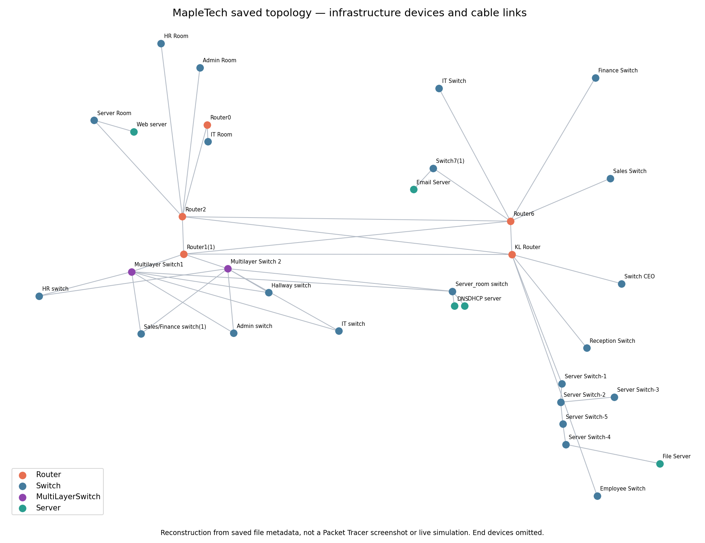
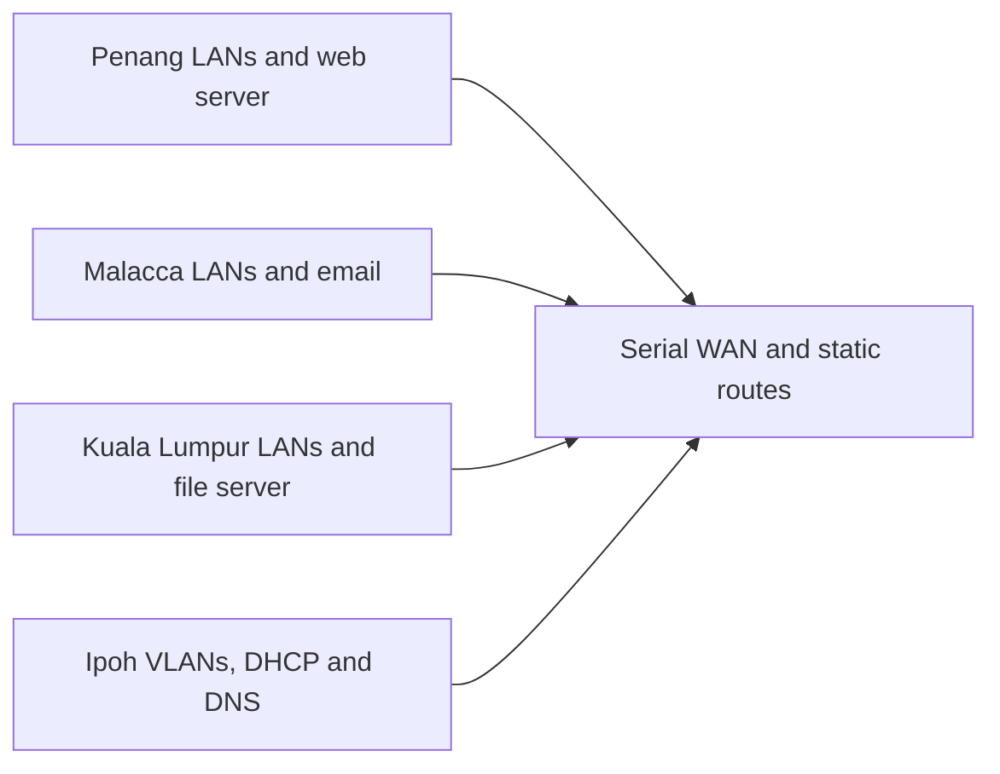

# MapleTech — Four-Branch Network Design

A Cisco Packet Tracer coursework design connecting a fictional company's Penang, Malacca, Kuala Lumpur and Ipoh branches. It combines subnetted LANs, a serial WAN, static routing, centralized services and IoT devices in a saved simulation project.

**Status:** saved configuration inspected. Live reachability, service behavior and activity completion were not verified in this review.



*Reconstructed from saved device coordinates and cable references. This is not a Packet Tracer screenshot or a fresh simulation; end devices are omitted for readability.*

## Design highlights

- Four branch networks with separate addressing requirements.
- Static routes across the WAN and VLAN-based networks in Ipoh.
- DHCP/DNS services in Ipoh, a Penang web server, Malacca email server and KL file server.
- A complete saved topology with **184 devices and 144 cable links**, verified against extracted metadata.



This is a configuration/design project. Device presence and saved links do not prove that traffic reaches every destination. The detailed guide records addressing, route and DHCP findings, including incomplete RIP configuration.

## Open and verify

Open `Working_Assignment_Final[1].pkt` in Cisco Packet Tracer 8.2.1 or a compatible version. Work on a copy, inspect each router's interfaces/routes, obtain a DHCP lease where intended and test cross-branch pings, DNS and service access in the simulator.

For the saved metadata evidence:

```bash
pip install matplotlib
python docs/verify_offline.py
```

The check matches the original file's SHA-256 to the inspected snapshot, validates metadata references and regenerates the infrastructure plot. It does not decode arbitrary Packet Tracer files or execute their simulation.

## Scope and documentation

The simulated-device credentials remain part of the saved academic artifact. Use it as a lab design; do not reuse those values for real devices. No configuration secrets were copied into the generated evidence metadata.

- [Detailed addressing, routing and service guide](docs/PROJECT_GUIDE.md)
- [Verification and evidence provenance](docs/VERIFICATION.md)
- [Captured saved-file checks](docs/results.txt)

Built with Cisco Packet Tracer; simulator software and device models belong to their respective owners.
